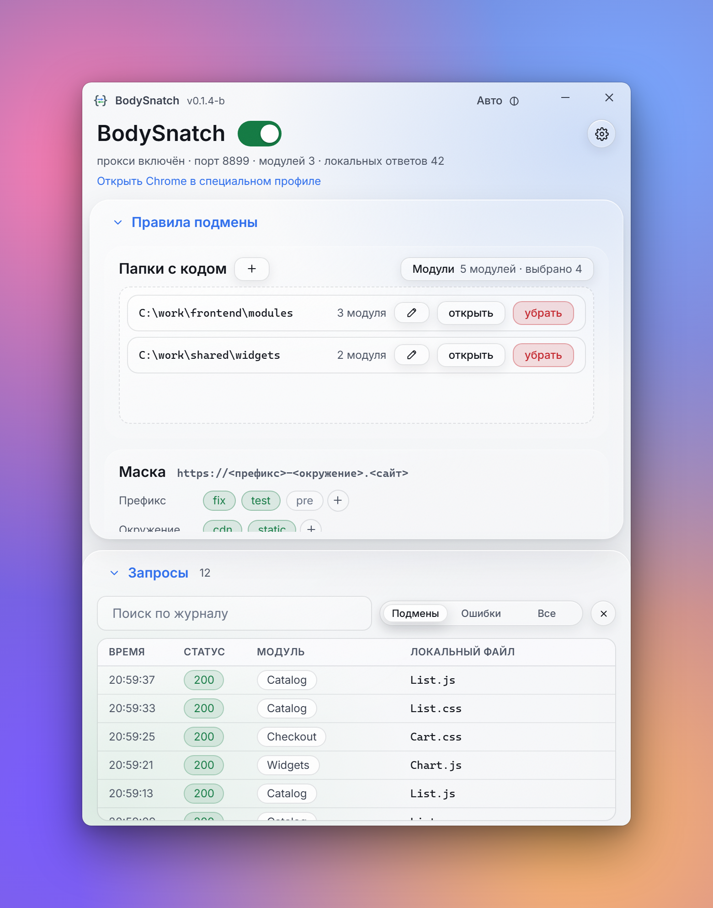
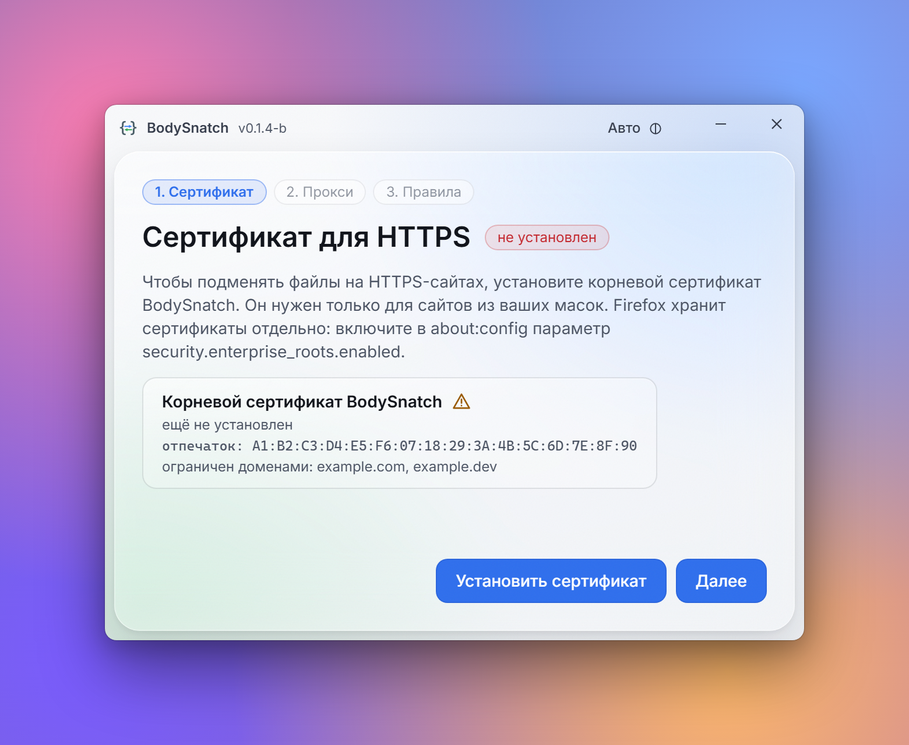
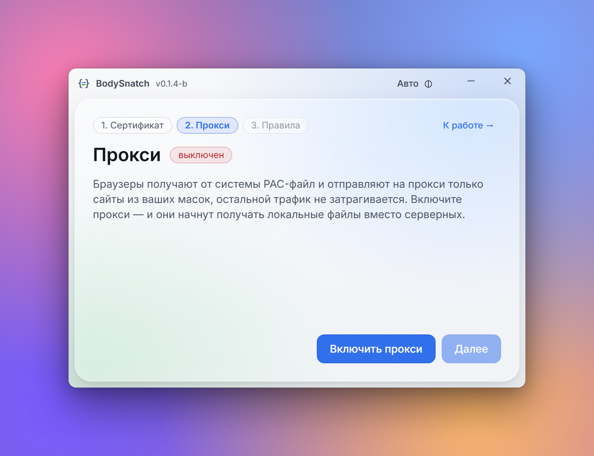

# BodySnatch Desktop

Подмена JS/CSS сайта локальными файлами через локальный MITM-прокси, без расширения
браузера. Работает с любым браузером, который использует системные настройки прокси
(Chrome, Edge, Yandex, Opera, Safari…). Windows и macOS.

Нужно, чтобы открыть тестовый стенд и увидеть на нём файлы из вашей рабочей папки: приложение
перехватывает запросы только к сайтам из заданной маски, а всё остальное браузер делает
напрямую.

## Скриншоты

Мастер настройки из трёх шагов и рабочий экран с журналом запросов. Адреса и папки на снимках вымышленные.

<p align="center">
  <picture>
    <source media="(prefers-color-scheme: dark)" srcset="docs/screenshots/working-dark.png">
    
  </picture>
</p>

<table>
  <tr>
    <td align="center"><b>1. Сертификат</b></td>
    <td align="center"><b>2. Прокси</b></td>
  </tr>
  <tr>
    <td>
      <picture>
        <source media="(prefers-color-scheme: dark)" srcset="docs/screenshots/certificate-dark.png">
        
      </picture>
    </td>
    <td>
      <picture>
        <source media="(prefers-color-scheme: dark)" srcset="docs/screenshots/proxy-dark.png">
        
      </picture>
    </td>
  </tr>
</table>

Тема окна переключается кнопкой в шапке (авто, светлая, тёмная); на GitHub картинки подстраиваются под вашу тему.

## Быстрый старт

1. Запустите приложение. При первом запуске покажется приветствие, нажмите «Начать».
2. **Сертификат.** Установите корневой сертификат BodySnatch. Windows покажет окно подтверждения,
   macOS покажет системное окно: введите пароль или приложите палец. Окно может открыться за другими; пока
   оно не подтверждено, установка ждёт. Если подтвердить не удалось, приложение покажет готовую
   команду для терминала. Он нужен, чтобы читать HTTPS сайтов из ваших масок.
3. **Прокси.** Включите прокси: система получит PAC-файл, и браузеры начнут отправлять на
   приложение только нужные сайты.
4. **Правила.** Добавьте папки с кодом, отметьте модули и проверьте маску сайта.
5. Рабочий экран: переключатель включает и выключает подмену вместе с системным PAC. В блоке
   «Запросы» виден журнал.

Закрытие окна на рабочем экране убирает его в трей (на macOS окно скрывается, приложение остаётся
в Dock); пункт «Остановить и выйти» в меню трея возвращает системные настройки и закрывает
приложение. На шагах настройки закрытие окна завершает приложение целиком.

При повторных запусках мастер не показывается: приложение сразу открывает рабочий экран, если корневой
сертификат установлен и покрывает домены масок; иначе откроется шаг «Сертификат». Приложение начинает
с выключенной подменой: PAC включает главный переключатель. Состояние PAC проверяется каждые 3 секунды;
если его выключит система или другая программа, подмена и переключатель тоже выключатся.
Вернуться в мастер можно кнопкой с шестерёнкой справа от названия на рабочем экране.

## Как выбирается файл

Адрес запроса сопоставляется с маской, затем с папками:

```
https://fix-cdn.sbis.ru/static/resources/Telephony_online/_call/Page.js?x_module=...
      └ хост по маске ┘└── служебный ──┘└──── модуль ────┘└── путь внутри модуля ──┘
                            префикс
```

- **Маска сайта**: `<префикс>-<окружение>.<сайт>`, например `fix-cdn.sbis.ru`. Префикс
  «отсутствует» даёт `<окружение>.<сайт>`. Каждое значение можно включать и выключать. Вместо
  маски можно задать свои шаблоны в `match` (см. конфигурацию).
- **Служебные префиксы** (`servicePrefixes`, например `static/resources`) отрезаются от пути.
- Первый сегмент оставшегося пути — **модуль**. Подменяются только выбранные модули.
- Файл ищется в папке, выбранной для модуля, затем в остальных папках. Для `X.js` также
  пробуется `X.min.js` и наоборот (то же для `.css`, `.tmpl`, `.html`). Запрос, выходящий за корень
  папки (`..`), отклоняется. Параметры запроса (`?x_module=…`) не учитываются.
- Подменяются только файлы с выбранными расширениями (поле «Файлы» в маске, по умолчанию `js` и
  `css`; нужное добавляется кнопкой «+»). Если список пуст, фильтра нет.
- Не найдено — запрос уходит на сервер как есть.

## Журнал запросов

Блок «Запросы» на рабочем экране: поиск и переключатель **Подмены / Ошибки / Все**.
Колонка «Тип» (для подмен «Модуль»):

| в интерфейсе                                 | значение (для поиска)                                      | что это                                                    |
| -------------------------------------------- | ---------------------------------------------------------- | ---------------------------------------------------------- |
| подмена, подмена · .min, подмена · др. папка | `mirror`, `mirror-min`, `mirror-other`, `mirror-other-min` | файл отдан из папки (в т.ч. `.min`-вариант, другой корень) |
| с сервера                                    | `passthrough`                                              | запрос ушёл на сервер без изменений                        |
| нет файла                                    | `map-miss`                                                 | модуль выбран, а файла в папках нет                        |
| WebSocket                                    | `websocket`                                                | WebSocket проксирован                                      |
| ошибка                                       | `error`                                                    | нет ответа сервера, сертификат, чтение файла               |

Подменённые ответы помечены заголовком `x-bodysnatch: <тип>:<путь к файлу>`: его видно во вкладке
Network браузера.

## Конфигурация

Правила хранятся в `rules.json` (путь см. ниже). Интерфейс правит их сам, но файл можно менять
вручную, пока приложение закрыто.

| ключ              | что делает                                                                                                                   |
| ----------------- | ---------------------------------------------------------------------------------------------------------------------------- |
| `port`            | порт прокси (по умолчанию 8180; занят — берётся следующий свободный)                                                         |
| `servicePrefixes` | префиксы пути, не входящие в локальный путь                                                                                  |
| `roots`           | папки с кодом (строки или `{ path, enabled }`)                                                                               |
| `moduleRoots`     | какие модули подменяются и из какой папки: `{ "Модуль": "C:\\путь" }`                                                        |
| `sites[]`         | сайты: `enabled`, `useLocal`, `mask { prefixes, envs, hosts }`, `files` (подменяемые расширения), `match` (свои шаблоны URL) |

## Как это устроено

```
браузер ── системный PAC http://127.0.0.1:8180/proxy.pac ──┐
   хост из маски?                                          │
   ├─ нет → идёт напрямую, приложение трафика не видит     │
   └─ да  → прокси 127.0.0.1:8180                          │
        ├─ HTTPS: CONNECT → TLS с нашим сертификатом хоста
        ├─ URL подходит под маску и модуль выбран?
        │    ├─ да, файл найден → отдаём его (x-bodysnatch: mirror)
        │    └─ нет → запрос уходит на сервер как есть
        └─ WebSocket, потоковые тела, HEAD, 304 — как у обычного прокси
```

- **Перехват только по маске.** PAC строится из тех же масок, что и правила, поэтому через
  прокси идут только нужные хосты. Банки, почта и остальное не затрагиваются. Если приложение
  закрыто или упало, PAC возвращает `DIRECT`, и сайты открываются как обычно.
- **Системные настройки.** Windows: `AutoConfigURL` в HKCU (права администратора не нужны).
  macOS: `networksetup` по всем сетевым службам (при отказе запрашивается пароль). Прежнее
  состояние сохраняется в `proxy-snapshot.json` и возвращается при выходе; после аварии оно
  возвращается при следующем запуске.
- **Кэш браузера.** На подменяемых хостах ответы получают `cache-control: no-cache`: браузер
  каждый раз спрашивает прокси, а неизменённый файл приходит ответом 304. С этих хостов также
  снимаются `Content-Security-Policy` и `X-Frame-Options`, они мешают отладке.
- **Движок в отдельном процессе.** Прокси, PAC и подпись сертификатов работают в Electron
  `utilityProcess` (`shell/engine-worker.cjs`), поэтому окно не подвисает, а падение движка не
  уносит интерфейс. Что умеет только основной процесс (шифрование ключа, диалоги), движок
  запрашивает у него по IPC.
- **Управление без окна.** Интерфейс общается с движком через протокол `app://` и IPC. Для агентов и
  скриптов есть отдельный API на случайном порту `127.0.0.1`, с Bearer-токеном из папки профиля.
  Из сети он недоступен; на порту прокси отдаётся только PAC. Подробнее — ниже.
- **Окно.** Размер задаёт приложение (под содержимое экрана и раскрытые блоки), изменить его
  мышью нельзя. Тема: авто, светлая или тёмная (кнопка в шапке).

## Обновления

Приложение само проверяет GitHub Releases: через 15 секунд после запуска, затем раз в 30 минут и при
возвращении в окно, если проверка была больше 10 минут назад. Запрос условный (ETag), ответ «не
изменилось» не расходует лимит API (60 запросов в час без токена), поэтому чаще проверять смысла
нет: релизы выходят редко.

Если вышла более новая версия, в шапке слева от переключателя темы появляется кнопка **«Обновить до X.Y.Z»** (текущая версия указана в шапке рядом с названием):

1. Клик начинает скачивание нужного установщика (`.exe` для Windows, `.dmg` под архитектуру на macOS).
   Вместо подписи кнопка показывает «скачано / всего МБ» и, если в шапке хватает места, скорость;
   по нижней кромке идёт тонкая полоска прогресса.
2. Файл проверяется по SHA-256 из метаданных релиза. После загрузки кнопка зеленеет, на миг
   появляется галочка, и подпись меняется на **«Установить X.Y.Z»**. Ширина кнопки на всех шагах одна и та же.
3. Клик по «Установить» возвращает системные настройки прокси, закрывает приложение и запускает
   установщик (на macOS открывается `.dmg`, приложение перетаскивается в «Программы»).

Если загрузка не удалась (сеть, неверная контрольная сумма), кнопка меняется на «Повторить».
Скачанный файл лежит во временной папке `BodySnatch-update` и при следующем запуске используется
повторно. Для проверки на своём сервере есть переменные `BODYSNATCH_UPDATE_URL` (адрес API
релиза), `BODYSNATCH_UPDATE_FIRST_MS` и `BODYSNATCH_UPDATE_DRYRUN=1` (установщик не запускается,
только пишется в журнал).

## Сертификат и безопасность

Прокси читает HTTPS, поэтому ему нужен собственный корневой сертификат, которому доверяет система.

- Корневой CA создаётся при первом запуске. Закрытый ключ шифруется средствами ОС (DPAPI /
  Keychain через Electron `safeStorage`) и лежит в папке данных, не в проекте.
- Листовые сертификаты выпускаются на лету и только для хостов из масок.
- Новый CA ограничен доменами из масок (расширение сертификата Name Constraints) (`sbis.ru`, `saby.ru`, `saby.top`…): даже при
  краже ключа им нельзя подписать чужой сайт. Если позже добавить домен вне ограничений,
  интерфейс предложит перевыпустить сертификат (его придётся установить заново); такие хосты до
  этого не вскрываются. CA прошлых версий остаётся без ограничений, пока его не перевыпустят.
- Удалить сертификат и ключ можно на шаге «Сертификат» («Удалить» / «Перевыпустить»): сертификат
  снимается из системы, приложение закрывается, а при следующем запуске создаётся новый.
- API управления доступен локальным клиентам с токеном, браузерные запросы к нему отклоняются.
  Программы того же пользователя и администратор не изолированы этим механизмом.

## Внешнее управление и скилл агента

Клиент сам запускает установленный BodySnatch 0.1.5+, если API ещё не работает, и ждёт его готовности.
Запуск фоновый; окно и DevTools не нужны. Для нестандартной сборки укажите `--app <путь>` или `BODYSNATCH_APP`.
`--no-start` запрещает автозапуск; `/api/quit` не запускает уже остановленное приложение.
Адрес и токен находятся в `<папка данных>/control-api.json`; они меняются при запуске. Не публикуйте этот файл.

```powershell
npm run api -- GET /api/state
npm run api -- GET /api/capabilities
npm run api -- POST /api/enabled '{"enabled":false}'
npm run api -- --body-file patch.json POST /api/config
```

В PowerShell для сложного JSON, особенно с путями, используйте `--body-file` с UTF-8 файлом.
Клиент требует Node.js 18+, сам читает токен и возвращает ненулевой код при ошибке.
Другой профиль: `--data-dir <папка>` или `BODYSNATCH_DATA_DIR`.

API охватывает подмену, системный PAC, правила, папки, выбор модулей, диагностику URL, журнал и SSE,
публичный сертификат и его установку/удаление, отдельный Chrome, тему, обновления и жизненный цикл приложения.
Установка CA по-прежнему может требовать подтверждения ОС; reset CA и установка обновления завершают приложение.
Режим без Electron не поддерживает команды окна и обновлений.

- [Контракт API и тела запросов](skills/bodysnatch-control/references/api.md).
- **Скилл агента поставляется в этом репозитории:** [bodysnatch-control](skills/bodysnatch-control/SKILL.md).
  Скопируйте всю папку `skills/bodysnatch-control`
  в папку навыков агента (для Codex — `~/.codex/skills`). В комплекте автономный клиент без зависимостей.
- [Результаты ревью и проверки](docs/review-2026-10-31.md).
- [Подключение Mac по SSH для проверки](docs/mac-verification.md).

Главное включение — одна команда `/api/enabled`. При `/api/browser/open` отдельный профиль браузера
может работать с подменой без системного PAC (`routeMode: browser`). Обычный режим — `routeMode: system`.

## Данные пользователя

| что                               | Windows                | macOS                                      |
| --------------------------------- | ---------------------- | ------------------------------------------ |
| папка данных                      | `%APPDATA%\BodySnatch` | `~/Library/Application Support/BodySnatch` |
| правила                           | `rules.json`           | `rules.json`                               |
| сертификат и (зашифрованный) ключ | `certs\`               | `certs/`                                   |
| прежние системные настройки       | `proxy-snapshot.json`  | `proxy-snapshot.json`                      |
| журнал приложения                 | `shell.log`            | `shell.log`                                |

При первом запуске `rules.json` создаётся из `config/rules.default.json`. В режиме разработки
(`npm run dev`, `npm run shell`) правила берутся из `config/rules.user.json`, если он есть (файл
в git не попадает).

## Структура

```
shell/            Electron: main.cjs (окно, трей, app://), engine-host.cjs и
                  engine-worker.cjs (движок в utilityProcess), updater.cjs (обновления),
                  preload.cjs, иконки
proxy/src/
  engine.mjs      сборка всего: конфиг, CA, прокси, системные настройки, API
  proxy.mjs       MITM: HTTP, CONNECT+TLS, туннель, подмена, WebSocket
  rules.mjs       маски, поиск сайта, хосты, разрешение локального файла
  pac.mjs         PAC из масок
  ca.mjs          корневой CA (Name Constraints) и листовые сертификаты
  upstream.mjs    прямые HTTP/HTTPS-запросы и TCP-туннели
  fileindex.mjs   кэш проверок файлов + fs.watch
  config.mjs      загрузка и атомарное сохранение правил
  scan.mjs        папки и модули для интерфейса
  api.mjs         маршруты API (без привязки к HTTP)
  httpapi.mjs     отладочный HTTP-сервер для API (npm start, Vite)
  control.mjs     авторизованный локальный API и файл обнаружения
  platform/       win32 / darwin / unsupported: системный прокси и сертификат
  main.mjs        запуск без Electron
ui/src/           React + Vite + Tailwind: screens/ (шаги и рабочий экран, заставка),
                  components/, ui/ (кнопки, поля, переключатель), lib/logo.ts (вектор иконки)
config/           rules.default.json
scripts/          dev-electron.mjs (Vite + Electron), make-icons.cjs (PNG из иконки)
build/            icon.png для electron-builder
test/             node --test
skills/           скилл агента с контрактом API и клиентом
```

## Разработка

```bash
npm install
npm run dev        # Vite 5179 + Electron, DevTools открываются сами
npm start          # без Electron: прокси + API на 8181, интерфейс в браузере
npm run splash     # открыть приветственный экран (показывается при первом запуске)
npm test           # юнит- и интеграционные тесты (системные настройки не трогаются)
npm run lint       # tsc + prettier + stylelint
npm run icons      # перегенерировать build/icon.png и shell/*.png из shell/icon.ico
# сквозная проверка перехвата на macOS: Actions → mac-e2e (сертификат + PAC + Chrome)
# отладка macOS без Mac: Actions → mac-smoke → Run workflow (собирает dmg на macOS-раннере,
# проверяет подпись, запускает приложение, возвращает логи и скриншот)
```

`npm start` принимает `--config`, `--certs`, `--state`, `--port`, `--api-port`. Тесты используют
поддельную платформу в памяти: реальный системный прокси и хранилище сертификатов они не трогают.
В режиме `dev` движок поднимает для Vite отладочный HTTP-API на 8181 (только loopback, с проверкой
Host и Origin).

Если в основном профиле CA уже зашифрован Electron, для `npm start` выберите отдельный профиль через
`BODYSNATCH_DATA_DIR` или отдельные `--config`, `--state`, `--certs`: Node без Electron не может расшифровать
ключ DPAPI/Keychain. Существующий зашифрованный CA при этом не заменяется.

Приветствие показывается один раз (флаг `bodysnatch.welcomed` в localStorage). Для проверки:
`npm run splash` или `?splash=1` в адресе.

## Релиз

```bash
npm run dist:win   # release/BodySnatch-<версия>-win-x64.exe (NSIS)
npm run dist:mac   # release/BodySnatch-<версия>-mac-{x64,arm64}.dmg — только на macOS
```

Сборка под macOS возможна только на Mac; для этого есть GitHub Actions
(`.github/workflows/release.yml`): по тегу `v*` проходят тесты, собираются оба установщика и
публикуется релиз. Версия берётся из `package.json`:

```bash
npm version 0.2.0 --no-git-tag-version && git commit -am "0.2.0" && git tag v0.2.0 && git push --follow-tags
```

**Подпись.** Сборки не подписаны сертификатом разработчика. Windows SmartScreen покажет
предупреждение («Подробнее → Выполнить в любом случае»). Пакет macOS подписывается ad-hoc
(`scripts/adhoc-sign.cjs`): иначе на Apple Silicon он открывается как «приложение повреждено». Теперь
Gatekeeper пишет «Файл не был открыт: Apple не удалось подтвердить…» (нотаризации нет). Нажмите
«Готово», затем «Системные настройки → Конфиденциальность и безопасность → Всё равно открыть». В macOS
Sequoia (15) и новее обход «правой кнопкой → Открыть» убран. Либо одной командой:
`xattr -dr com.apple.quarantine /Applications/BodySnatch.app`. Подпись и нотаризация требуют
сертификатов разработчика (Apple Developer ID, сертификат подписи кода Windows).

## Ограничения и известные проблемы

- **Linux не поддерживается**: прокси работает, но PAC и сертификат нужно настраивать вручную
  (`http://127.0.0.1:<порт>/proxy.pac`, `certs/rootCA.pem`).
- **Firefox** хранит сертификаты отдельно. В `about:config` включите
  `security.enterprise_roots.enabled`, и он начнёт доверять системному хранилищу.
- Наружу ведётся только HTTP/1.1: HTTP/2 на вскрытых хостах не договаривается.
- Сертификат на macOS проверяется командой `security verify-cert`; результат может отличаться
  от того, что видит конкретный браузер.

## Если что-то не работает

- **Подмена не срабатывает.** Откройте «Запросы» → «Ошибки»: «нет файла» (`map-miss`) значит, что модуль
  выбран, а файла в папках нет (проверьте путь и служебные префиксы). Если запроса нет в журнале
  вообще, хост не подпадает под маску или PAC не включён.
- **Браузер ругается на сертификат.** Установите сертификат на шаге «Сертификат»; на Windows
  после установки перезапустите браузер. Для Firefox см. выше. Если маска вышла за домены
  сертификата, перевыпустите его.
- **Под VPN подмена не работает (macOS).** Активный VPN-туннель (Packet Tunnel) перекрывает системный
  прокси; на рабочем экране появится предупреждение. Кнопка «Открыть Chrome в специальном профиле» запускает
  Chrome (или Edge) в отдельном профиле с PAC и доверием к корню прямо во флагах — это работает в
  обход системных настроек и VPN. Chrome покажет предупреждение о неподдерживаемом флаге, это ожидаемо.
- **Системный прокси остался включённым после сбоя.** Запустите приложение ещё раз: оно само вернёт
  прежние настройки. Вручную: Windows, «Параметры → Сеть → Прокси» (скрипт настройки),
  macOS, «Настройки → Сеть → Прокси → Автоконфигурация прокси».
- **Логи.** `shell.log` в папке данных; движок пишет туда же.
